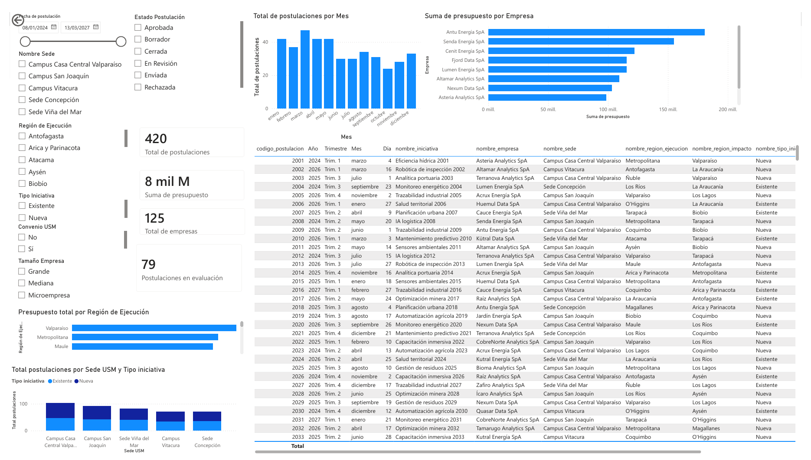
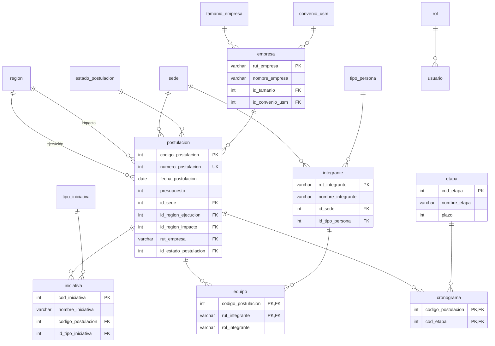
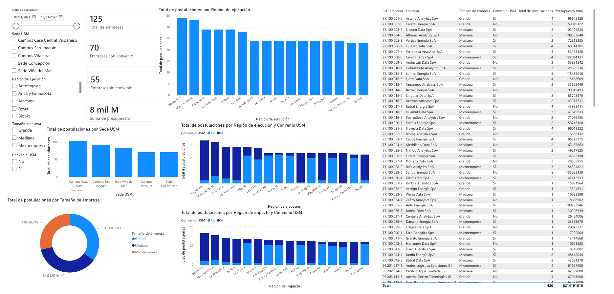

# Postulaciones CT-USM: base de datos y dashboards

Base de datos relacional en MySQL y dos dashboards en Power BI para gestionar las postulaciones de iniciativas al **Centro Tecnológico de la USM (CT-USM)**, que evalúa y financia proyectos de estudiantes y profesores junto a empresas externas.

Proyecto del ramo **Bases de Datos (INF-239)** de la Universidad Técnica Federico Santa María (2026-1), desarrollado en tres entregas: modelamiento, normalización e implementación, y análisis con Power BI.

<p align="center">
  
</p>

## Contexto

El CT-USM recibía las postulaciones mediante un formulario. El objetivo fue digitalizar ese proceso: diseñar una base de datos que represente el formulario y sus reglas de negocio, y luego construir tableros de control para monitorear el programa.

Algunas de las reglas que el modelo debía respetar:

- Cada postulación corresponde a una iniciativa **nueva o existente**, se asocia a una **sede USM** y a una **empresa externa** principal.
- Tiene una **región de ejecución** y una **región de impacto**, que no necesariamente son la misma.
- El equipo de trabajo debe tener **al menos 3 profesores y 5 estudiantes**.
- Cada postulación tiene un **cronograma** de al menos 3 etapas y un **estado** (borrador, enviada, en revisión, aprobada, rechazada o cerrada).

## Modelo de datos

La base está normalizada a **tercera forma normal (3FN)**. Los valores fijos (regiones, sedes, tamaños de empresa, estados, tipos de iniciativa y de persona) se modelan como **tablas de catálogo**, y las relaciones de muchos a muchos se resuelven con tablas intermedias: `equipo` (postulación ↔ integrante) y `cronograma` (postulación ↔ etapa).



El diagrama muestra solo los atributos principales. El esquema completo, con tipos y restricciones, está en [`BD/DDL.sql`](BD/DDL.sql).

## Datos

**Todos los datos son ficticios**: empresas, RUT, personas, iniciativas, presupuestos y fechas fueron generados para que el análisis fuera realista. La base contiene:

| Elemento | Cantidad |
|---|---|
| Postulaciones | 420 |
| Empresas externas | 125 |
| Integrantes de equipos | 1.660 (entre 8 y 12 por postulación) |
| Etapas asignadas a cronogramas | 1.713 |
| Regiones / sedes | 16 / 5 |

## Dashboards

Power BI se conecta a la base MySQL e importa las tablas, además de dos vistas SQL que reúnen la información para el análisis: `vw_postulacion_gestion` (postulación, empresa, sede, regiones, tipo, convenio, presupuesto, fecha y estado) y `vw_equipo_gestion` (integrantes de cada equipo).

Como una postulación se relaciona dos veces con `region` (ejecución e impacto) y la sede aparece tanto en postulaciones como en integrantes, en el modelo de Power BI se duplicaron esas tablas para que cada relación quede activa y los filtros funcionen por separado.

**Dashboard 1: control general de postulaciones y presupuesto.** Responde cuántas postulaciones hay, cómo evolucionan en el tiempo, dónde se concentran y cuánto presupuesto está en juego. Incluye filtros por fecha, sede, región, tipo de iniciativa, convenio, tamaño de empresa y estado; indicadores de total de postulaciones, presupuesto total, empresas y postulaciones en evaluación; y gráficos por mes, empresa, región y sede.

**Dashboard 2: empresas, convenios y territorio.** Muestra qué empresas participan, cuántas tienen convenio con la USM y cómo se distribuyen las postulaciones por región de ejecución, región de impacto, sede y tamaño de empresa.

<p align="center">
  
</p>

El informe con la explicación del modelo de Power BI está en [`docs/informe_dashboards.pdf`](docs/informe_dashboards.pdf).

## Estructura del repositorio

| Ruta | Contenido |
|---|---|
| `BD/DDL.sql` | Creación de la base de datos, tablas, claves y vistas |
| `BD/DML.sql` | Poblamiento con los datos ficticios |
| `PowerBI/dashboards_postulaciones.pbix` | Archivo de Power BI con los dos dashboards |
| `docs/informe_dashboards.pdf` | Informe del modelo de datos de Power BI |
| `imagenes/` | Capturas de los dashboards |

## Cómo ejecutarlo

**Requisitos:** [XAMPP](https://www.apachefriends.org/) (o cualquier servidor MySQL/MariaDB) y [Power BI Desktop](https://www.microsoft.com/power-platform/products/power-bi/desktop) en Windows. Para que Power BI se conecte a MySQL puede ser necesario instalar el **MySQL Connector/NET**.

1. Inicia **Apache** y **MySQL** desde el panel de XAMPP y abre phpMyAdmin (`http://localhost/phpmyadmin`).
2. En la pestaña **SQL**, pega y ejecuta el contenido de `BD/DDL.sql`. Esto crea la base `ct_usm_postulaciones`.
3. Selecciona la base `ct_usm_postulaciones` y ejecuta de la misma forma el contenido de `BD/DML.sql` para cargar los datos.
4. Abre `PowerBI/dashboards_postulaciones.pbix` y haz clic en **Inicio → Actualizar**. Si pide los datos de conexión, usa:

   | Parámetro | Valor |
   |---|---|
   | Servidor | `localhost` (puerto `3306`) |
   | Base de datos | `ct_usm_postulaciones` |
   | Usuario | `root` |
   | Contraseña | *(vacía)* |

Si prefieres la terminal, los scripts también se pueden cargar con el cliente de MySQL, indicando la codificación para que se respeten las tildes:

```bash
mysql -u root --default-character-set=utf8mb4 < BD/DDL.sql
mysql -u root --default-character-set=utf8mb4 ct_usm_postulaciones < BD/DML.sql
```

## Tecnologías

MySQL / MariaDB · SQL · phpMyAdmin · XAMPP · Power BI Desktop

## Autores

- Juan Carlos San Martín
- Matías Jorquera

El proyecto completo del ramo incluyó también una aplicación web en PHP que operaba sobre esta base de datos. Este repositorio se enfoca en el modelo de datos y el análisis con Power BI.
